# Consultancy Project
Internal management of offices that host psychological counseling centers or expert-client relations
is a web project developed for the execution of the appointment system in digital environment.
The head of the central management unit keeps the records of experts and clients working in the
management on the web side. Consultancy centers with login operations management
facilities are available. The admin panel is available. Entity Framework Core (Code First) is used for data access, and the appointment calendar is built with FullCalendar (create, edit, drag & drop, per-expert filter, conflict check).

C#, ASP.NET Core MVC (.NET 10), MSSQL Server, Entity Framework Core Code First, ASP.NET Core Identity, LINQ,
Bootstrap 5.3 + Bootstrap Icons, FullCalendar 6 (vendored under `wwwroot/lib`), light/dark theme.

## Screenshots

Taken from the running app with fictional demo data.

**Landing page**

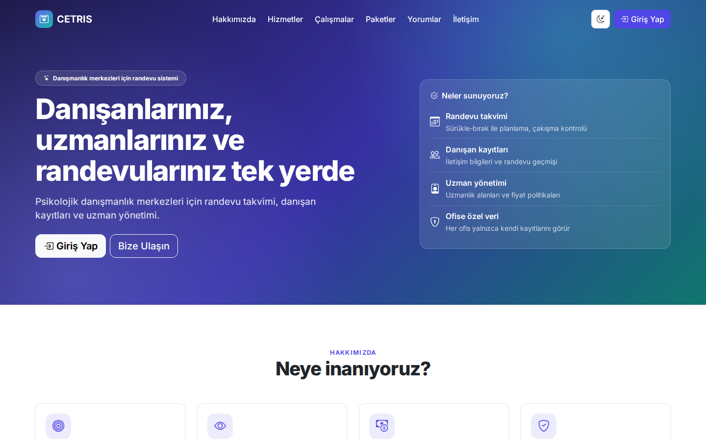

| Services | Plans |
|---|---|
| 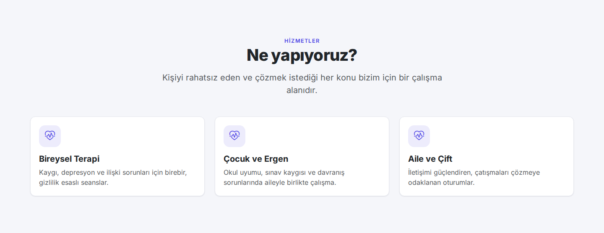 | 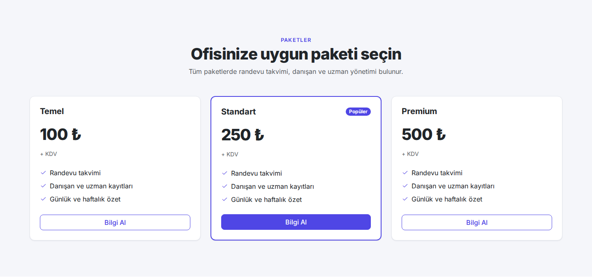 |

**Office panel**

| Dashboard | Appointment calendar |
|---|---|
| 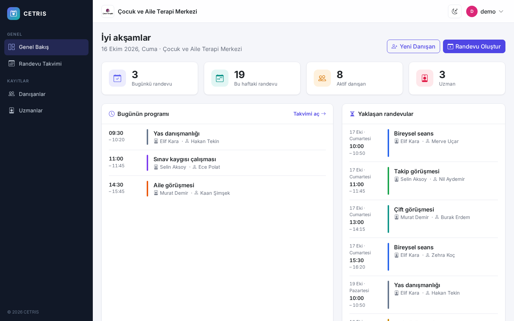 | 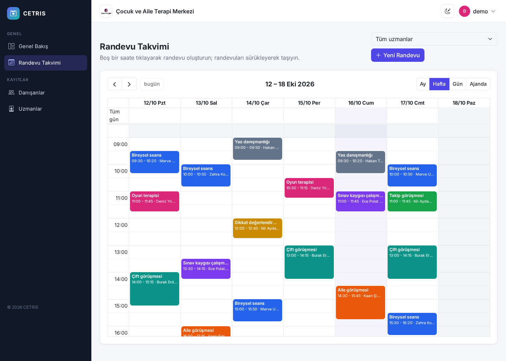 |
| **Appointment form** | **Dark theme** |
| 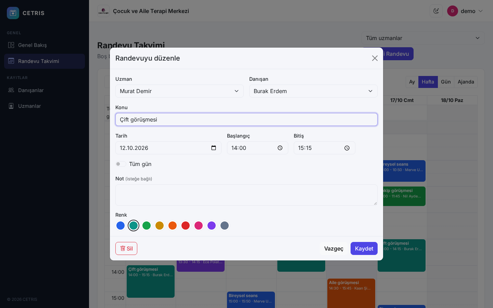 | 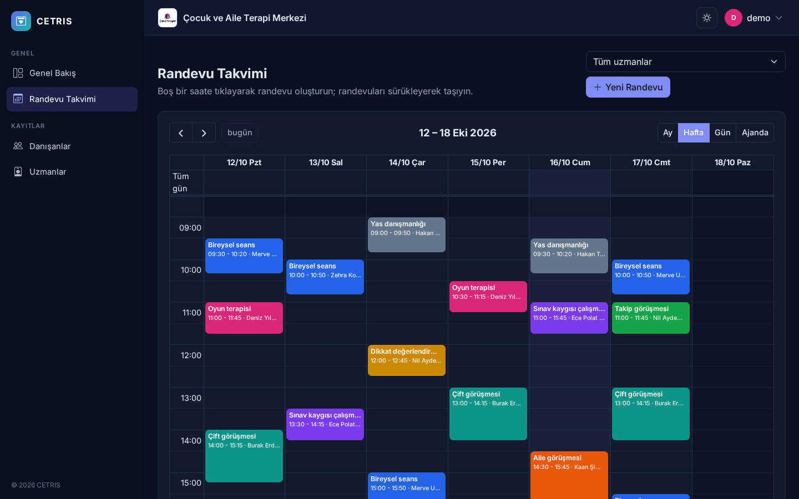 |
| **Clients** | **Client detail** |
| 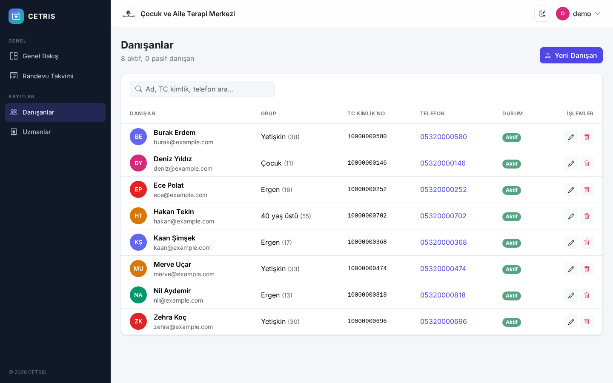 | 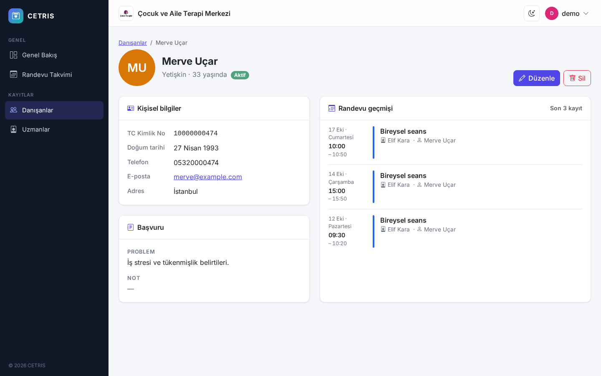 |
| **Experts** | **Sign in** |
| 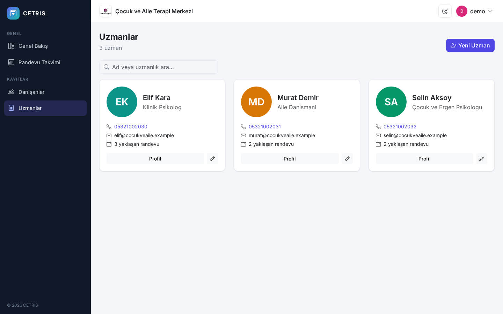 | 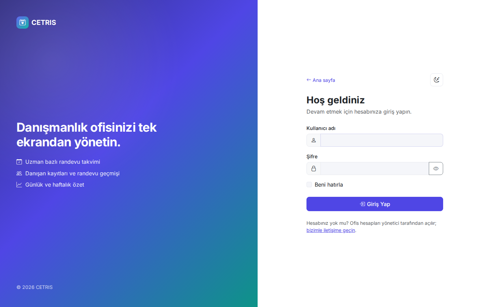 |

**Admin panel**

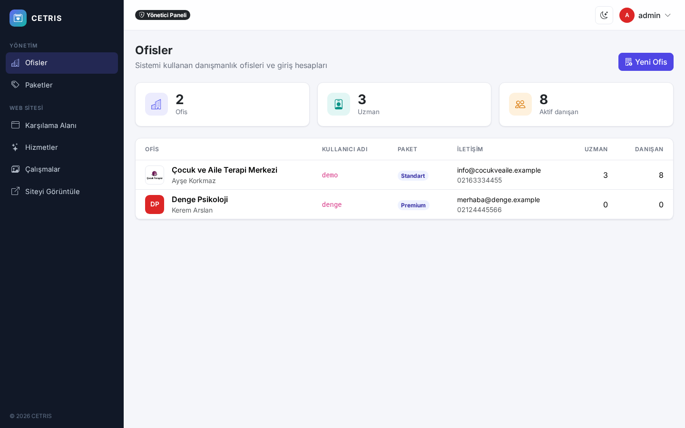

**Mobile**

<p>
  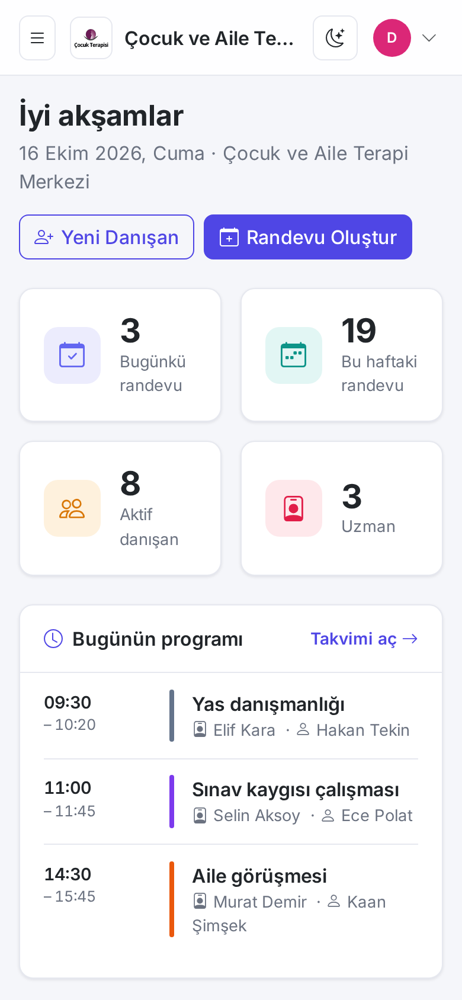
  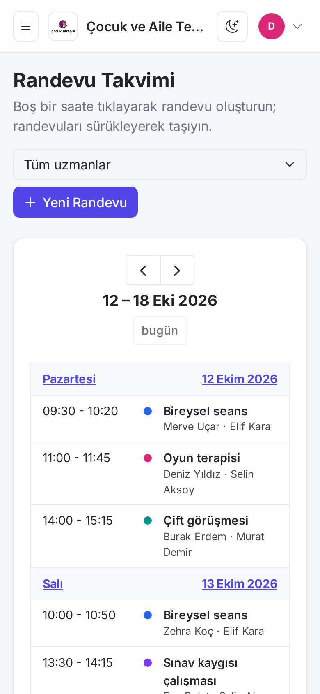
</p>

## Running

### With Docker (recommended)

```bash
cd OfficeAppointmentSoftware
docker compose up --build
```

Open http://localhost:8080 and sign in with `admin` / `Admin123!` (set `ADMIN_PASSWORD` to change it).
The admin creates offices from **Kullanıcı İşlemleri** (sign-up); each office then signs in with its own user.
SQL Server is exposed on `localhost,14333` (`sa` / `MSSQL_SA_PASSWORD`, default `Local_Dev_Passw0rd`).
Migrations are applied and the roles are seeded on startup.

### Locally

Requires the .NET 10 SDK and a SQL Server instance.

```bash
cd OfficeAppointmentSoftware/OfficeAppointmentSoftware.MVC.WebUI
dotnet user-secrets set "ConnectionStrings:AppointmentDBContext" "Server=localhost,1433;Database=AppointmentDB;User Id=sa;Password=<password>;TrustServerCertificate=True"
dotnet user-secrets set "Seed:AdminPassword" "<admin password>"
dotnet run
```

The contact form sends mail only when the `Smtp` section is configured (keep `Smtp:Password` in user secrets or environment variables).

### Migrations

There are two contexts in the same database: `AppointmentDBContext` (DAL) and `IdentityContext` (WebUI).

```bash
cd OfficeAppointmentSoftware
dotnet tool restore
dotnet ef migrations add <Name> -p OfficeAppointmentSoftware.DAL -s OfficeAppointmentSoftware.MVC.WebUI -c AppointmentDBContext -o Migrations
dotnet ef migrations add <Name> -p OfficeAppointmentSoftware.MVC.WebUI -s OfficeAppointmentSoftware.MVC.WebUI -c IdentityContext -o Migrations
```
